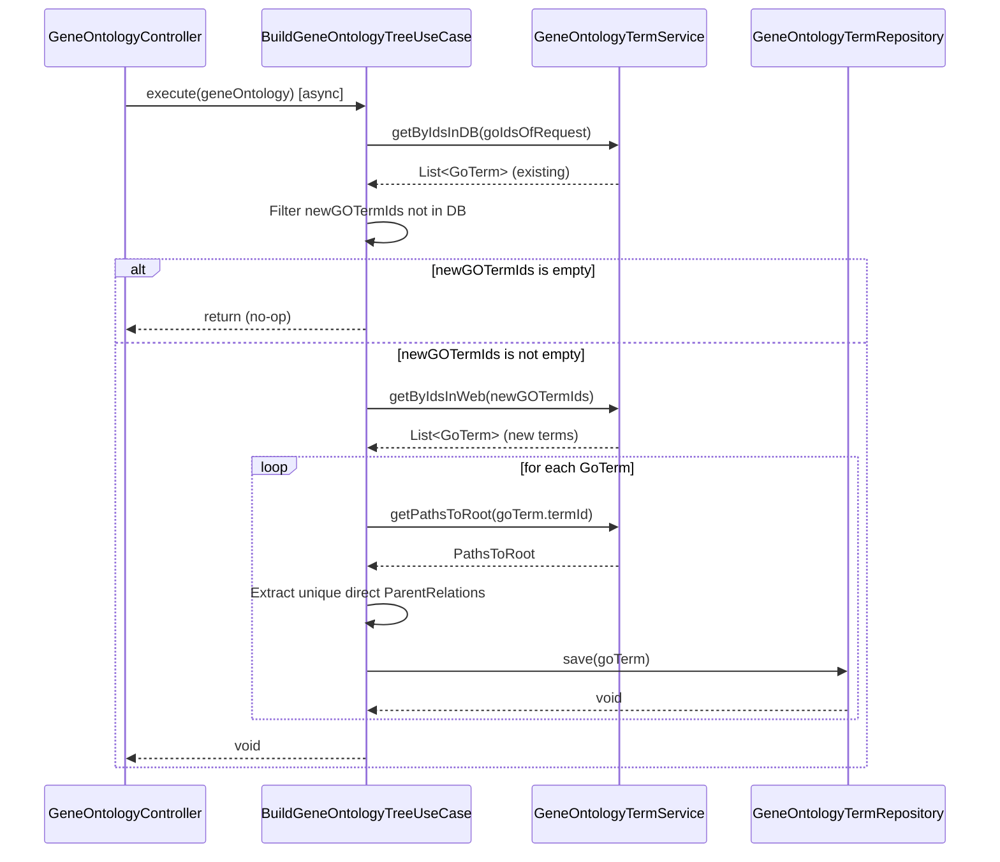

# BuildGeneOntologyTreeUseCase

## 1. Business Problem and Purpose
Biological objects in BioPatternsG reference Gene Ontology (GO) term identifiers whose hierarchical metadata and parent relationships are needed for ontology analysis. This use case ensures that any requested GO term IDs not yet stored locally are fetched from the EBI QuickGO API, enriched with their direct parent relationships, and persisted in the `gene_ontology` MongoDB collection.

## 2. Contracts
- **Inbound Port:** `com.biopatternsg.domain.port.in.BuildGeneOntologyTree`
  - `void execute(GeneOntologyBuildTreeRequest geneOntology)`
- **Outbound Ports:**
  - `com.biopatternsg.domain.port.out.repositories.GeneOntologyTermRepository`
    - `void save(GoTerm goTerm)`
- **Application Services:**
  - `com.biopatternsg.application.services.GeneOntologyTermService`
    - `List<GoTerm> getByIdsInDB(List<String> ids)`
    - `List<GoTerm> getByIdsInWeb(List<String> ids)`
    - `PathsToRoot getPathsToRoot(String goId)`
- **Delivery Adapter:** `GeneOntologyController#buildTreeGO` (`POST /gene-ontology/build-tree`, executed asynchronously via `CompletableFuture.runAsync(...)` with `202 Accepted`).

## 3. Execution Flow
1. Extract `goTermIds` from `GeneOntologyBuildTreeRequest` and query existing terms in MongoDB via `geneOntologyTermService.getByIdsInDB(goIdsOfRequest)`.
2. Compute `newGOTermIds` by filtering out IDs already present in `gene_ontology`.
3. If `newGOTermIds` is empty, log completion and return early (idempotent no-op).
4. Fetch metadata (`termId`, `name`, `synonyms`) for all missing GO IDs in bulk from EBI QuickGO via `geneOntologyTermService.getByIdsInWeb(newGOTermIds)`.
5. For each fetched `GoTerm`:
   1. Query its hierarchical paths toward GO roots (`GO:0008150;GO:0003674;GO:0005575`) via `geneOntologyTermService.getPathsToRoot(goTerm.getTermId())`.
   2. Flatten all returned paths, filter edges where `pathToRoot.getChild().equals(termId)`, deduplicate them in a `Set`, and map each edge into `GoTerm.ParentRelation(parent, relationship)`.
   3. Assign `parentRelations` to the `GoTerm` and persist it via `goTermRepository.save(goTerm)`.

## 4. Sequence Diagram

## 5. Exceptions, Caching, and Failure Scenarios
- **Idempotency:** Already-persisted GO term IDs are skipped before calling EBI QuickGO, avoiding redundant external calls and duplicate documents.
- **Request Validation:** `GeneOntologyBuildTreeRequest` is validated at the controller boundary via `@Valid`.
- **External / Persistence Failures:** Because execution runs asynchronously inside `GeneOntologyController#buildTreeGO`, any runtime exception from EBI QuickGO (`ebi-api`) or MongoDB is caught and logged in the background worker without changing the already-returned HTTP `202 Accepted` response.
