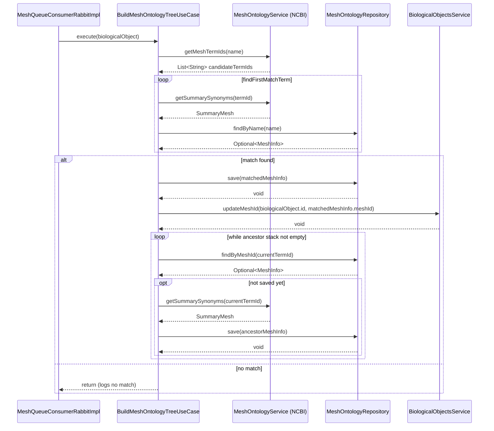

# BuildMeshOntologyTreeUseCase

## 1. Business Problem and Purpose
To support hierarchical classification and semantic analysis of biological objects using Medical Subject Headings (MeSH), the system must resolve each biological object to its MeSH descriptor, persist its complete ancestor chain up to the MeSH root in MongoDB (`mesh_ontology`), and link the resolved `meshId` back to the biological object in `search-biological-objects`.

## 2. Contracts
- **Inbound Port:** `com.biopatternsg.domain.port.in.BuildMeshOntologyTree`
  - `void execute(BiologicalObject biologicalObject)`
- **Outbound Ports:**
  - `com.biopatternsg.domain.port.out.repositories.MeshOntologyRepository`
    - `void save(MeshInfo meshInfo)`
    - `Optional<MeshInfo> findByName(String name)`
    - `Optional<MeshInfo> findByMeshId(String meshId)`
- **Application Services:**
  - `com.biopatternsg.application.services.MeshOntologyService`
    - `List<String> getMeshTermIds(String objectName)`
    - `SummaryMesh getSummarySynonyms(String meshTermId)`
  - `com.biopatternsg.application.services.BiologicalObjectsService`
    - `void updateMeshId(String biologicalObjectId, String meshId)`
- **Delivery Adapter:** `MeshQueueConsumerRabbitImpl#consumer` (RabbitMQ `@Incoming("ncbi-in")`, `@Blocking`, queue `mesh-queue`).

## 3. Execution Flow
1. Guard against a `null` `BiologicalObject`. If `name` is `null` or blank, fall back to `symbol.trim()`; if both are missing, log a warning and return early.
2. Search candidate MeSH term IDs in NCBI E-utilities (`esearch.fcgi`) via `meshOntologyService.getMeshTermIds(name)`.
3. Find the first matching MeSH term (`findFirstMatchTerm`):
   1. For each candidate `termId`, retrieve its summary (`parents` and `meshSynonyms`) from NCBI (`esummary.fcgi`) via `meshOntologyService.getSummarySynonyms(termId)`.
   2. Re-check if `name` is already persisted (`meshOntologyRepository.findByName(name)`); if so, stop and return `Optional.empty()`.
   3. Compare normalized MeSH synonyms against normalized `biologicalObject.getSynonyms()` (lowercased with whitespace, hyphens, and underscores stripped).
   4. On the first synonym match, build and return `MeshInfo(meshId, name, synonyms, parents)`.
4. If no match is found, log and return early.
5. Persist the matched `MeshInfo` in `mesh_ontology` via `meshOntologyRepository.save(matchTermId)`.
6. Notify `search-biological-objects` with the resolved `meshId` via `biologicalObjectsService.updateMeshId(biologicalObject.getId(), matchTermId.getMeshId())`.
7. Push all parent IDs of the matched node onto a `Stack<String>` and iteratively build the ancestor tree:
   1. Pop `currentTermId`; if `meshOntologyRepository.findByMeshId(currentTermId)` already exists, skip it.
   2. Fetch `SummaryMesh` via `meshOntologyService.getSummarySynonyms(currentTermId)`.
   3. Derive `name` from the first synonym (or `currentTermId` if empty) and `synonyms` from the remaining entries.
   4. Save the ancestor `MeshInfo` in `mesh_ontology` and push its parents onto the stack until empty.

## 4. Sequence Diagram

## 5. Exceptions, Caching, and Failure Scenarios
- **Null / Blank Guard:** Safely skips `null` objects or objects missing both `name` and `symbol`.
- **Incremental Tree Caching:** During upward traversal, any ancestor whose `meshId` already exists in `mesh_ontology` is skipped, preventing redundant NCBI requests and avoiding infinite loops on shared ancestor branches.
- **Rate Limiting & External Failures:** `QueryMeshImpl` applies a 500 ms delay before NCBI calls and strips XML `DOCTYPE` declarations via `DoctypeRemovalFilter`. Any exception during message processing is caught and logged inside `MeshQueueConsumerRabbitImpl#consumer`.
