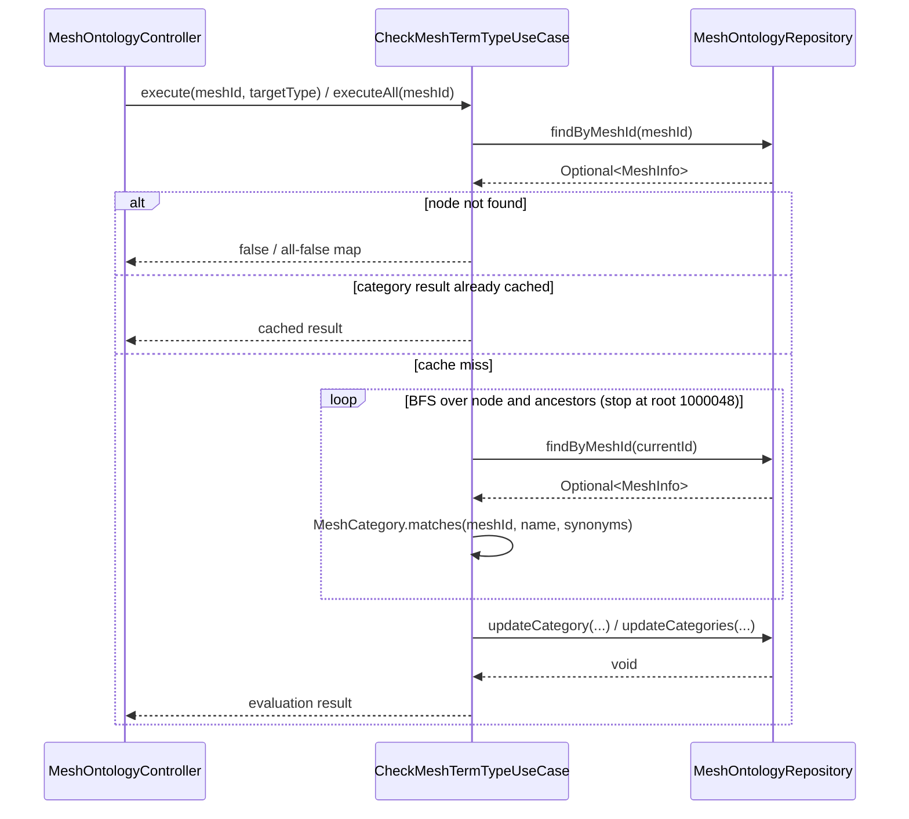

# CheckMeshTermTypeUseCase

## 1. Business Problem and Purpose
Downstream biological workflows need to classify whether a MeSH term represents a specific biological category (`PROTEIN`, `ENZYME`, `RECEPTOR`, `LIGAND`, `TRANSCRIPTION_FACTOR`, or `ADAPTOR_PROTEIN`). Because category membership can be inherited from ancestor descriptors in the MeSH hierarchy, this use case traverses the stored ancestor graph in `mesh_ontology` using Breadth-First Search (BFS) and caches the computed classification flags directly on the MeSH document for fast subsequent lookups.

## 2. Contracts
- **Inbound Port:** `com.biopatternsg.domain.port.in.CheckMeshTermType`
  - `boolean execute(String meshId, MeshCategory targetType)`
  - `Map<MeshCategory, Boolean> executeAll(String meshId)`
- **Outbound Ports:**
  - `com.biopatternsg.domain.port.out.repositories.MeshOntologyRepository`
    - `Optional<MeshInfo> findByMeshId(String meshId)`
    - `void updateCategory(String meshId, String category, boolean isType)`
    - `void updateCategories(String meshId, Map<String, Boolean> categories)`
- **Application Services:** None.
- **Delivery Adapter:**
  - `MeshOntologyController#checkType` (`POST /mesh-ontology/check-type` -> `CheckMeshTypeResponse`).
  - `MeshOntologyController#checkAllTypes` (`POST /mesh-ontology/check-all-types` -> `CheckAllMeshTypesResponse`).

## 3. Execution Flow

### 3.1. Single Category Evaluation (`execute`)
1. Validate that `meshId` is non-null/non-blank and `targetType` is non-null; otherwise log a warning and return `false`.
2. Trim `meshId` and load the initial node via `meshOntologyRepository.findByMeshId(initialMeshId)`. If absent, log a warning and return `false`.
3. Check the document's `categories` cache map: if `targetType.name()` is already present, return the cached boolean immediately.
4. Perform an upward BFS starting from `initialMeshId` using a `Queue<String>` and a `visited` set:
   1. Evaluate `targetType.matches(term.getMeshId(), term.getName(), term.getSynonyms())`.
   2. On the first match, cache `true` via `meshOntologyRepository.updateCategory(initialMeshId, targetType.name(), true)` and return `true`.
   3. Otherwise enqueue all non-blank, unvisited parent IDs that are not the MeSH root term (`1000048`, checked via `MeshCategory.isRootTerm(...)`).
5. If the queue exhausts without a match, cache `false` via `meshOntologyRepository.updateCategory(initialMeshId, targetType.name(), false)` and return `false`.

### 3.2. All Categories Evaluation (`executeAll`)
1. Validate that `meshId` is non-null/non-blank; otherwise return `Collections.emptyMap()`.
2. Load the initial node via `meshOntologyRepository.findByMeshId(trimmedId)`. If absent, return a map with every `MeshCategory` set to `false`.
3. Populate `resultMap` from any already-cached entries in `term.getCategories()` and collect missing categories in `pendingCategories`.
4. If `pendingCategories` is empty, return `resultMap` immediately from cache.
5. Run a single upward BFS while `!queue.isEmpty() && !pendingCategories.isEmpty()`:
   1. Test each remaining pending category against the current node; mark matches `true` and remove them from `pendingCategories`.
   2. Stop early if all pending categories have matched; otherwise enqueue non-blank, unvisited, non-root (`1000048`) parents.
6. Persist the complete map via `meshOntologyRepository.updateCategories(trimmedId, stringResultMap)` and return `resultMap`.

## 4. Sequence Diagram

## 5. Exceptions, Caching, and Failure Scenarios
- **Cache-First Persistence:** Computed results are persisted directly inside `mesh_ontology.categories` (`updateCategory` for single checks, `updateCategories` for full classification), avoiding repeated BFS traversals on subsequent requests.
- **Cycle & Root Safety:** A `visited` set prevents infinite loops in cyclic parent links, and `MeshCategory.isRootTerm("1000048")` prevents traversing past the top-level MeSH tree root.
- **Request Validation:** `CheckMeshTypeRequest` (`@NotBlank meshId`, `@NotNull type`) and `CheckAllMeshTypesRequest` (`@NotBlank meshId`) are validated via `@Valid` at `MeshOntologyController` (`400 Bad Request` on invalid payloads).
- **Unknown MeSH Node:** Missing nodes do not throw exceptions and are not cached; `execute` returns `false` and `executeAll` returns an all-`false` map for all `MeshCategory` values.
