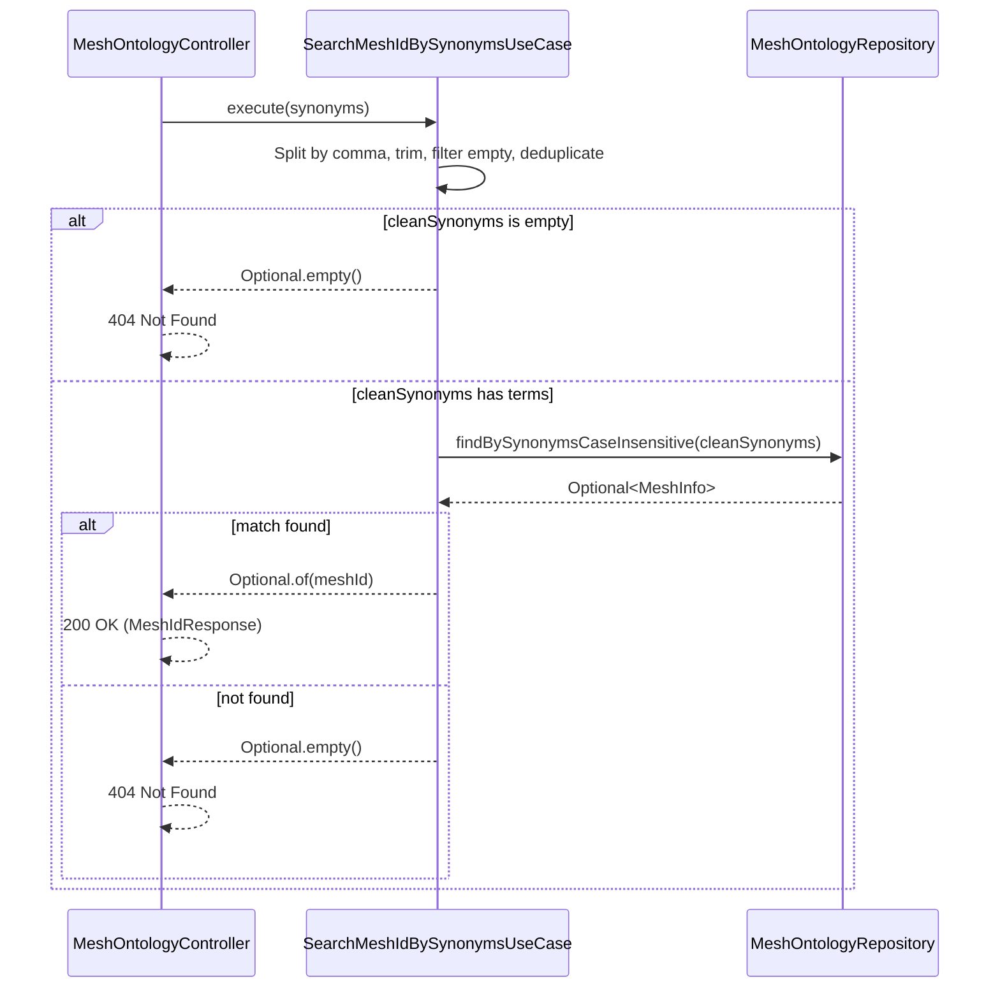

# SearchMeshIdBySynonymsUseCase

## 1. Business Problem and Purpose
Other microservices in BioPatternsG often possess a list of gene/protein names or synonyms and need to resolve the corresponding `meshId` stored in the local `mesh_ontology` collection without triggering external NCBI lookups. This use case normalizes the incoming synonyms and performs a case-insensitive exact match against stored MeSH terms.

## 2. Contracts
- **Inbound Port:** `com.biopatternsg.domain.port.in.SearchMeshIdBySynonyms`
  - `Optional<String> execute(List<String> synonyms)`
- **Outbound Ports:**
  - `com.biopatternsg.domain.port.out.repositories.MeshOntologyRepository`
    - `Optional<MeshInfo> findBySynonymsCaseInsensitive(List<String> synonyms)`
- **Application Services:** None.
- **Delivery Adapter:** `MeshOntologyController#searchMeshId` (`POST /mesh-ontology/search-mesh-id`, returning `200 OK` with `MeshIdResponse` or `404 Not Found`).

## 3. Execution Flow
1. Validate that the input `synonyms` list is neither `null` nor empty; otherwise log a warning and return `Optional.empty()`.
2. Clean and normalize the synonym list:
   - Filter out `null` elements.
   - Split comma-separated entries (`s.split(",")`).
   - Trim whitespace, filter out empty strings, and deduplicate values (`distinct()`).
3. If `cleanSynonyms` is empty after sanitization, log a warning and return `Optional.empty()`.
4. Query MongoDB via `meshOntologyRepository.findBySynonymsCaseInsensitive(cleanSynonyms)` (anchored case-insensitive regex `^...$` across both `name` and `synonyms` fields in `mesh_ontology`).
5. If a `MeshInfo` document matches, log the match and return `Optional.of(match.getMeshId())`; otherwise return `Optional.empty()`.

## 4. Sequence Diagram

## 5. Exceptions, Caching, and Failure Scenarios
- **Request Validation:** `SearchMeshIdRequest` enforces `@NotEmpty` via Bean Validation (`400 Bad Request` on invalid payloads).
- **Safe Regex Matching:** `MeshOntologyRepositoryAdapter#findBySynonymsCaseInsensitive` escapes each term with `Pattern.quote(s)` so special characters in biological synonyms (e.g., parentheses, brackets, plus signs) cannot break regex evaluation.
- **Not Found Behavior:** No domain exception is thrown when no term matches; `Optional.empty()` is returned and translated to HTTP `404 Not Found` by `MeshOntologyController#searchMeshId`.
