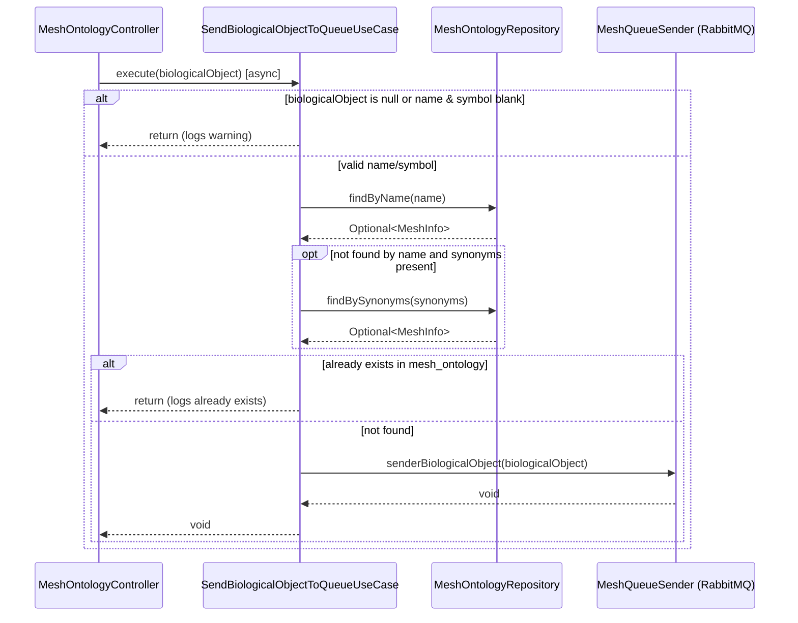

# SendBiologicalObjectToQueueUseCase

## 1. Business Problem and Purpose
Constructing MeSH ontology trees requires rate-limited XML calls against NCBI E-utilities, which would block HTTP callers if executed synchronously. This use case acts as the ingestion gatekeeper: it validates and normalizes an incoming `BiologicalObject`, checks whether a corresponding MeSH term is already stored in `mesh_ontology`, and enqueues only unseen objects to RabbitMQ for asynchronous tree construction.

## 2. Contracts
- **Inbound Port:** `com.biopatternsg.domain.port.in.SendBiologicalObjectToQueue`
  - `void execute(BiologicalObject biologicalObject)`
- **Outbound Ports:**
  - `com.biopatternsg.domain.port.out.repositories.MeshOntologyRepository`
    - `Optional<MeshInfo> findByName(String name)`
    - `Optional<MeshInfo> findBySynonyms(List<String> synonyms)`
  - `com.biopatternsg.domain.port.out.producers.MeshQueueSender`
    - `void senderBiologicalObject(BiologicalObject biologicalObject)`
- **Application Services:** None.
- **Delivery Adapter:** `MeshOntologyController#buildTreeMesh` (`POST /mesh-ontology/mesh`, executed asynchronously via `CompletableFuture.runAsync(...)` with `202 Accepted`).

## 3. Execution Flow
1. Guard against a `null` `BiologicalObject`; if `null`, log a warning and return early.
2. Normalize the primary lookup name:
   - If `name` is `null` or blank, fall back to `symbol.trim()` when `symbol` is present and non-blank.
   - If both `name` and `symbol` are `null` or blank, log a warning and skip queue dispatch.
3. Check local existence in `mesh_ontology`:
   - Query `meshOntologyRepository.findByName(biologicalObject.getName())`.
   - If not found by name and `synonyms` is non-empty, query `meshOntologyRepository.findBySynonyms(biologicalObject.getSynonyms())`.
4. If a matching MeSH entry already exists, log that the MeSH tree already exists and return early without enqueuing.
5. Otherwise, publish the `BiologicalObject` to RabbitMQ via `meshRabbitSender.senderBiologicalObject(biologicalObject)` (`ncbi-out` -> `exchange-ncbi` / `mesh-queue`).

## 4. Sequence Diagram

## 5. Exceptions, Caching, and Failure Scenarios
- **Null / Blank Input Protection:** `null` payloads or objects lacking both `name` and `symbol` are safely skipped with a warning log instead of failing downstream queue consumers.
- **Deduplication / Idempotency:** Existing MeSH records matched by exact `name` or `synonyms` prevent redundant RabbitMQ messages and NCBI calls.
- **Messaging Failures:** Any RabbitMQ emission error thrown by `MeshQueueSenderRabbitAdapter` is rethrown and caught/logged by the async worker in `MeshOntologyController#buildTreeMesh`.
